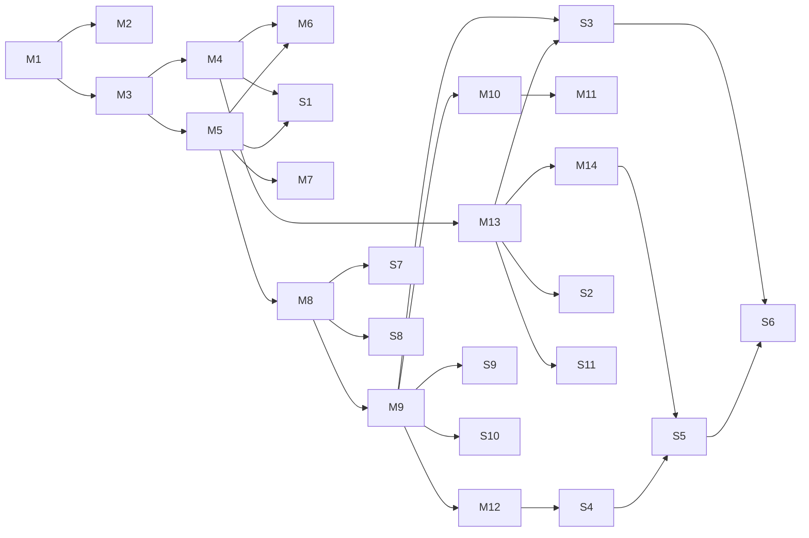

# Tutorial — what players need to know (teach list)
> Discovery draft, 2026-10-12. Ordered by **skill chains** (Dan Cook, Lostgarden): each thing names what it **needs** first, so the tutorial never teaches a rule before the one it stands on. /define locks this list, the order and the "how".
> Words: **plant** (not cast — everywhere, Muzzy 2026-10-12) · **nudge** = a pop-up after X seconds doing nothing OR after a wrong action · **tip** = a one-time pop-up when something first happens · **rails** = the scripted opening of the tutorial game.

## How each thing can be taught
| How | What it is |
|---|---|
| 🛤️ Rails | the scripted opening: told exactly what to do, the board is set up so it works |
| 💡 Tip | shows once, the first time it happens in a game (Settings → Tips) |
| 👉 Nudge | idle for X s, or a wrong action → points at what you *can* do |
| ❔ Explore | only in the "?" mode — tap the thing, read about it |

## 1. MUST know — can't play without it
| # | Thing | Needs | Taught by |
|---|---|---|---|
| M1 | These two glyphlings are yours (your colour) | — | 🛤️ draft |
| M2 | Draft: place on a hex that isn't on the edge, not next to another glyphling | M1 | 🛤️ "drag here" |
| M3 | Move: one glyphling, in a straight line along the 3 directions, as far as you like, can't pass through or land on anything | M1 | 🛤️ turn 1 · 👉 idle "Drag one of your glyphlings to a new spot" |
| M4 | Pieces block — anyone's seeds and glyphlings stop a move (blocked paths) | M3 | 🛤️ turn 1 |
| M5 | Plant: from where the glyphling landed, a seed flies in a straight line, any distance, to an empty hex | M3 | 🛤️ turn 1 (step 1 Move → step 2 Plant) · 👉 idle after the move |
| M6 | It flies over **your own** pieces, not other players' | M5, M4 | 🛤️ turn 1 |
| M7 | Try freely, then **Plant** commits (tap the ghost / seed to take it back, Undo) | M5 | 🛤️ turn 1 · 👉 idle "Tap Plant when you're happy" |
| M8 | Words: through the new seed, in a straight line, read top→bottom / left→right, 3+ letters | M5 | 🛤️ turn 2 |
| M9 | Magic: +1 per letter, your own seeds +2 (the score pops show it) | M8 | 🛤️ turn 2 |
| M10 | You only make Magic by spelling a word | M9 | 🛤️ turn 1 (no word yet) |
| M11 | Spelled nothing → swap any seeds for new ones (refresh) | M10 | 🛤️ turn 1 |
| M12 | Goal: end with the most Magic | M9 | overview |
| M13 | Tangled = a glyphling that can't move | M3, M4 | overview · 💡 first danger cue |
| M14 | The game ends when ANY 2 glyphlings are tangled — yours count too | M13 | overview · 💡 first tangle |

## 2. SHOULD know — to play well and not be surprised
| # | Thing | Needs | Taught by |
|---|---|---|---|
| S1 | Plant to hem glyphlings in — **area control first, spelling second** (the original's rule #1) | M4, M5 | 🛤️ turn 1 (the plant also blocks a path) |
| S2 | Danger: a glyphling with 1 move left (the cue) | M13 | 💡 first time |
| S3 | You gain +3 Magic for each of your pieces next to an opponent's glyphling when it gets tangled | M13, M9 | 💡 first tangle (the tutorial AI makes it likely) |
| S4 | Magic is secret until the end | M12 | 💡 after the first word ("only you saw that") |
| S5 | You can end it yourself — tangle your own glyphling when you think you're ahead | M14, S4 | 💡 one tangle already, late game |
| S6 | Tangle next to your own seeds and nobody gains from it | S3, S5 | ❔ / 💡 with S5 |
| S7 | One seed can make several words (each direction) — they light up one at a time | M8 | 💡 first time |
| S8 | Only your longest word through the seed counts on that line | M8 | 💡 first time it drops a word · ❔ |
| S9 | Grow someone else's word — your seeds in it still count +2 | M9 | 💡 first time (the AI leaves a half-word) |
| S10 | The Plant button shows the Magic before you commit | M9 | 💡 first time it shows a number |
| S11 | Hemmed in by a glyphling → freed when it moves away | M13 | ❔ |
| S12 | Can move but can't plant → just move | M5 | 💡 if it happens |

## 3. NICE to know — let them find it (❔ Explore, or the end screen)
Tray reorder + shuffle · pinch zoom + Fit · word indicators / hide seeds options · draw 1 after a word (automatic) · ties share the win · Q is a plain Q · the bag can run out · awards + Story + Scorecard · Submit a word · the two-birds plant (word + block) · Hijack / Bridge.

## Chain (needs → thing)

## Sketch of the tutorial game (to discuss — not decided)
- **Overview** (≤ 3 cards): Move then plant · most Magic wins · ends when any 2 glyphlings are tangled.
- **Draft — rails:** "Drag here" for both glyphlings → a set-up board for the next turns.
- **Turn 1 — rails** (Muzzy's opening): move (a blocked path shows) → plant (blocks a path / flies over your own piece) → no word → refresh. Covers M3–M7, M10, M11, S1.
- **Turn 2 — rails?** spell the first word with a stacked hand → M8, M9, S4, S10.
- **Turn 3 — rails?** the AI left a half-word → grow it → S9.
- **Then free play** vs the tutorial AI (basic; tends to get ONE of its glyphlings tangled) — 💡 tips fire on first events (S2, S3, S5, S7, S8), 👉 nudges on idle / wrong actions.
- Open: how many rails turns · do nudges start during rails or only after · can you lose the tutorial game (and does it matter).
